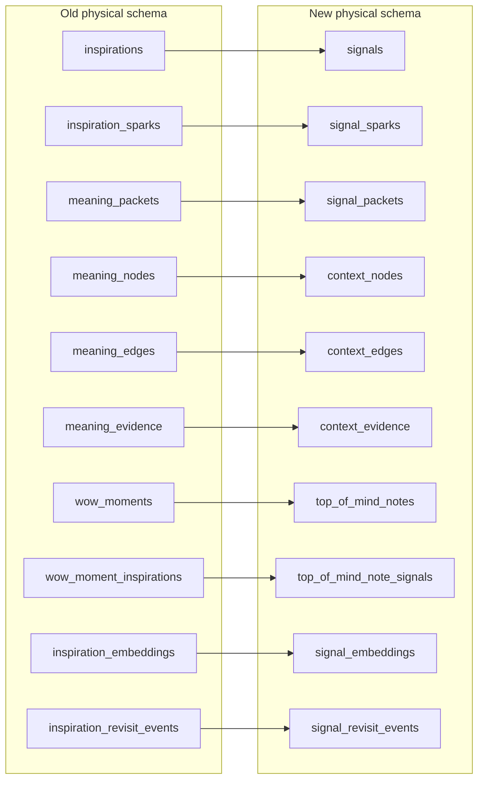
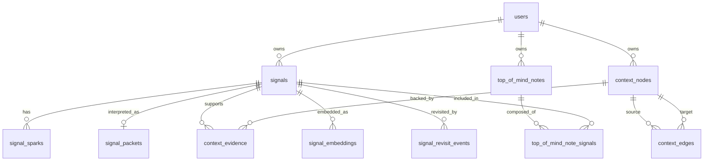
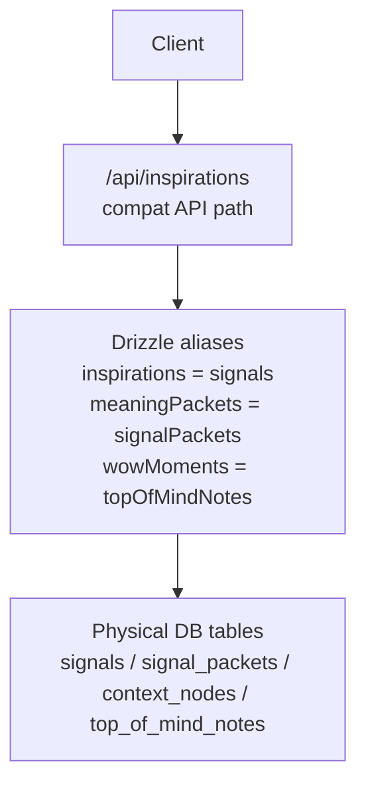
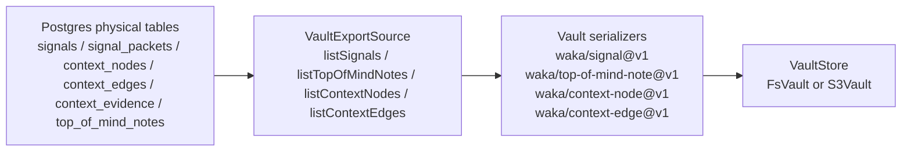

# Old Schema To New Schema Cutover

This documents the persistence vocabulary cutover from the old inspiration /
meaning / wow-moment table names to the new signal / context / top-of-mind
schema.

## Table Mapping

## New Relationship Shape

## Column Mapping

| Old | New |
| --- | --- |
| `inspiration_id` | `signal_id` |
| `packet_id` | `signal_packet_id` |
| `meaning_node_id` | `context_node_id` |
| `source_node_id` | `source_context_node_id` |
| `target_node_id` | `target_context_node_id` |
| `evidence_inspiration_ids` | `evidence_signal_ids` |
| `wow_moment_id` | `top_of_mind_note_id` |

## Compatibility Layer

The client-facing `/api/inspirations` path remains for compatibility. The
physical database writes now go through the new `signals` table and related
signal/context/top-of-mind tables.

## DB To Vault Export

Current vault paths:

| Document | Path |
| --- | --- |
| Signal | `{userId}/signals/YYYY/MM/{signalId}.yaml` |
| Top-of-mind note | `{userId}/top-of-mind/YYYY/MM/{noteId}.yaml` |
| Context node | `{userId}/context/nodes/{type}--{slug}--{contextNodeId}.yaml` |
| Context edge | `{userId}/context/edges/{sourceSlug}--{kind}--{targetSlug}--{contextEdgeId}.yaml` |

This is still the export/backfill side of file SSOT. The full SSOT flip needs
the next phases: dual-write file first, add the `documents` index, add reindex,
then flip reads.
